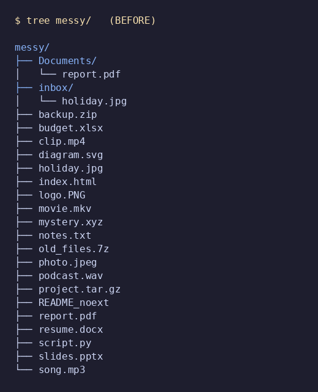
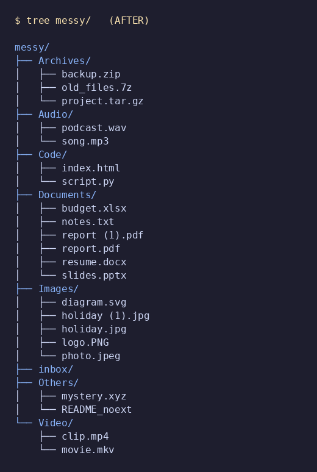

# File Organizer

A small, dependency-free Python CLI that sorts the files in a directory into
subfolders by type (`Images`, `Documents`, `Archives`, `Audio`, `Video`, `Code`,
and `Others` for anything unrecognised).

- **Never overwrites** an existing file.
- **Deterministic conflict handling**: `report.pdf` becomes `report (1).pdf`, then `report (2).pdf`, and so on. The smallest free number is used, and files are processed in sorted order, so the same input always gives the same result.
- **Configurable** source directory, target base directory and categories.
- **Dry-run** mode that prints every planned move and changes nothing.
- **Log file** option for an audit trail.

Requires Python 3.9+ (tested on 3.11). No third-party packages are needed to run
the organizer. Pillow is only used by `render_tree.py` to make screenshots.

## Usage

```
python organizer.py SOURCE [-t TARGET] [-c CONFIG] [-n] [-l LOGFILE] [-r]
```

| Option | Meaning |
|---|---|
| `SOURCE` | Directory whose files are sorted (required). |
| `-t, --target DIR` | Base directory where category folders are created. Defaults to `SOURCE`. |
| `-c, --config FILE` | JSON file with custom categories (see `config.example.json`). |
| `-n, --dry-run` | Show planned moves; don't touch any file. |
| `-l, --log FILE` | Also write the log to `FILE`. |
| `-r, --recursive` | Also sort files found in subfolders of `SOURCE`. |

### Examples

```bash
# 1. Preview what would happen (safe)
python organizer.py ~/Downloads --dry-run

# 2. Sort in place and keep a log
python organizer.py ~/Downloads --log run.log

# 3. Sort into a different base directory
python organizer.py ~/Downloads --target ~/Sorted

# 4. Include subfolders, with custom categories
python organizer.py ~/Downloads -r -c config.example.json

# 5. Preview to a log file only
python organizer.py ~/Downloads -n -l plan.log
```

Exit codes: `0` success, `2` bad source directory or config path.

### Configuration

```json
{
  "fallback": "Others",
  "categories": {
    "Images": [".jpg", ".png"],
    "Ebooks": [".epub", ".mobi"]
  }
}
```

Extensions are matched case-insensitively. Files whose extension is not listed
go to the `fallback` folder. If an extension is listed under two categories, the
first one wins. A config **replaces** the built-in categories.

### How name conflicts work

| Situation | Result |
|---|---|
| `Documents/report.pdf` exists, moving another `report.pdf` | `Documents/report (1).pdf` |
| `report.pdf` and `report (1).pdf` both exist | `report (2).pdf` |
| Two source files (e.g. `a.jpg` and `inbox/a.jpg`) map to the same name in one run | First in sorted order keeps `a.jpg`, the second becomes `a (1).jpg` |

The dry run reserves destination names the same way, so what it prints is exactly
what a real run does. Renamed moves are flagged `[renamed: name conflict]`.

### Notes

- Only `SOURCE`'s top level is scanned unless `--recursive` is given. Category
  folders inside the target are skipped, so re-running is safe (idempotent).
- Symlinks are ignored. Empty folders left behind by `--recursive` are not removed.
- Multi-part extensions such as `.tar.gz` are classified by the last suffix (`.gz`).

## Sample run

Generate the messy demo directory, preview, then run for real:

```bash
python make_sample.py samples/messy
python organizer.py samples/messy --recursive --dry-run --log docs/dry_run.log
python organizer.py samples/messy --recursive --log docs/sample_run.log
```

The demo includes an existing `Documents/report.pdf` and a duplicate
`holiday.jpg` in `inbox/` to show conflict handling.

**Before**



**After**



Full logs: [`docs/dry_run.log`](docs/dry_run.log) and [`docs/sample_run.log`](docs/sample_run.log).
Excerpt:

```
Organizer started (LIVE) source=samples/messy target=samples/messy
MOVE  samples/messy/inbox/holiday.jpg  ->  samples/messy/Images/holiday (1).jpg  [renamed: name conflict]
MOVE  samples/messy/report.pdf  ->  samples/messy/Documents/report (1).pdf  [renamed: name conflict]
Summary: Archives=3, Audio=2, Code=2, Documents=5, Images=5, Others=2, Video=2
Done: 21 files moved (2 renamed to avoid conflicts).
```

## Tests

```bash
python -m unittest discover -s tests -v
```

The 8 tests cover type sorting, case-insensitive extensions, no-overwrite and
numbering, same-name conflicts within one run, dry-run equivalence, separate
target directory, idempotency, custom config, log file and error handling.

## Repo layout

```
organizer.py           the CLI
config.example.json    sample category config
make_sample.py         builds the demo directory
render_tree.py         renders tree screenshots (needs Pillow)
tests/                 unit tests
docs/                  screenshots and sample logs
```
